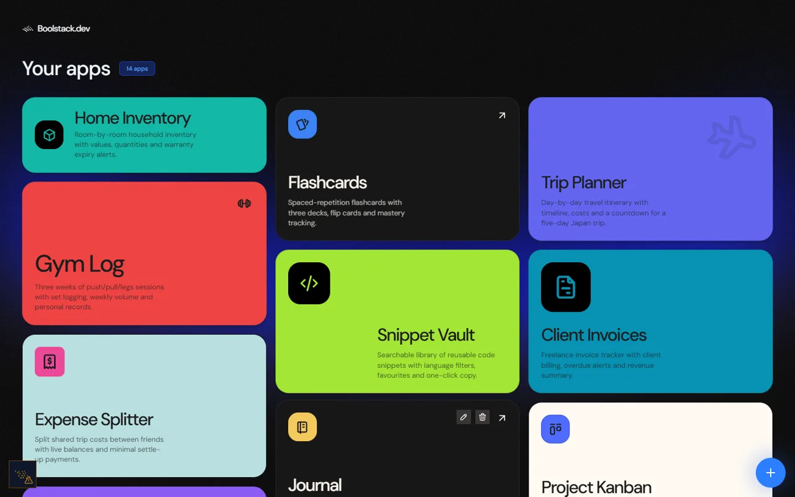
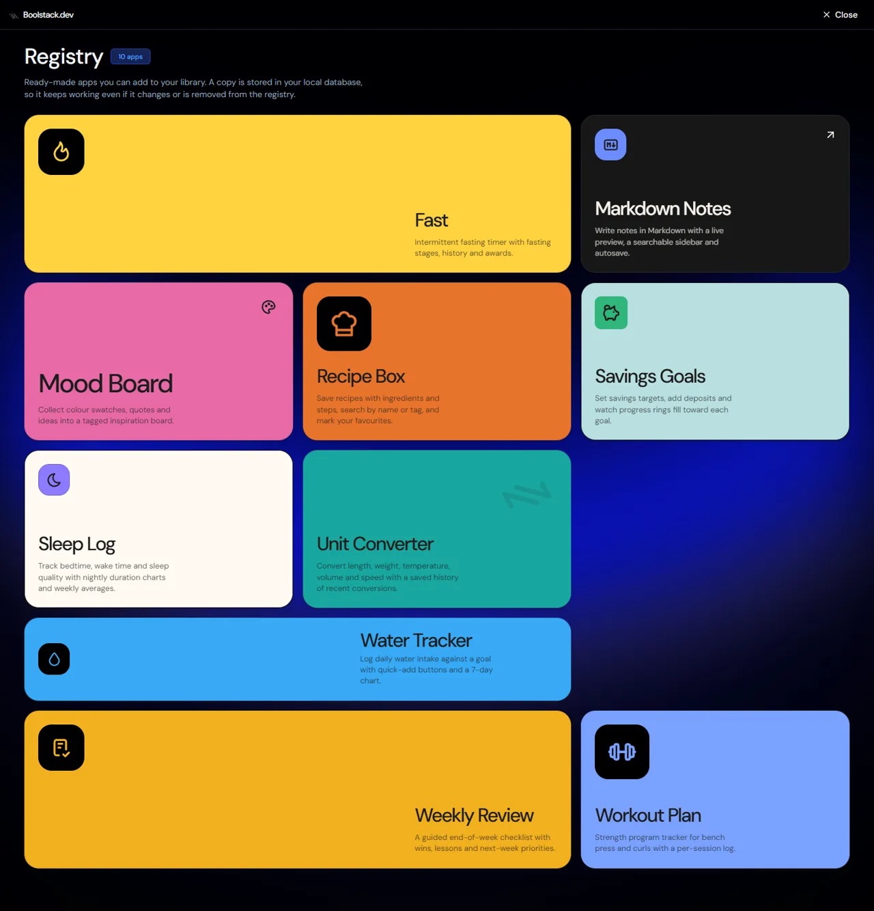

# Boolstack

A local-first launcher for your personal single-file HTML apps. Keep the little apps your AI assistant builds for you (a habit tracker, a budget calculator, a flashcard deck) in one dashboard. Your apps and their data live in your browser and are backed up to a folder you choose. No account, no server-side storage.



## Features

- **Single-file apps.** Each app is one self-contained `.html` file. Upload your own or add a ready-made one from the built-in registry.
- **Local-first storage.** Apps and their data are stored in a [PGlite](https://pglite.dev) (Postgres in WebAssembly) database in your browser.
- **Folder backup.** Pick a folder and Boolstack writes a `backup.tar.gz` there after changes, and restores from it when needed (File System Access API, Chromium browsers).
- **Per-app `localStorage`.** Each app runs in a sandboxed iframe with its own namespaced `localStorage`, synced into the database so it is backed up too.
- **Registry.** Browse, preview (nothing is saved) and add sample apps from the `registry/` directory.
- **Installable PWA.** A service worker caches the app shell so the launcher opens offline.
- **Accessible.** Built to WCAG 2.2 AA.
- **Mobile friendly.** Apps show up as icons on a phone.



## How it works

Boolstack is a Next.js app, but almost everything happens in the browser. On first run it creates a PGlite database in IndexedDB (or loads one from your backup folder). Uploaded HTML is stored as text in that database and shown in a sandboxed iframe via a blob URL, with a small script injected that swaps `localStorage` for a namespaced proxy. Every change is reported to the launcher, written to the database, and a debounced backup is written to your folder. The only server-side code is a read-only API that lists and serves the sample apps in `registry/`. See [docs/architecture.md](docs/architecture.md).

## Requirements

- Node.js 20 or newer
- [pnpm](https://pnpm.io/installation)
- A Chromium-based browser (Chrome, Edge, etc.) if you want folder backups. Other browsers do not support the File System Access API.

## Quick start

```bash
pnpm install
pnpm dev
```

`pnpm dev` starts the dev server with `--experimental-https`, so open the HTTPS URL it prints (usually `https://localhost:3000`). On first run Next.js generates a local certificate with mkcert into the git-ignored `certificates/` directory, and may prompt to install a local CA. See [docs/development.md](docs/development.md) for details.

For a production build:

```bash
pnpm build
pnpm start
```

## Scripts

| Script | What it does |
| --- | --- |
| `pnpm dev` | Dev server (webpack, HTTPS) |
| `pnpm build` | Production build (webpack) |
| `pnpm start` | Serve the production build |
| `pnpm lint` | Run ESLint |
| `pnpm typecheck` | Type-check with `tsc --noEmit` |

## Project structure

```
app/
  api/registry/     Read-only registry API (the only server code)
  components/       UI: launcher grid, viewer, editor, registry browser, onboarding
  guide/            In-app user guide page
  lib/              Database, backup, storage bridge, registry helpers
components/ui/      shadcn/ui primitives
content/            user-guide.md (rendered at /guide)
docs/               Project documentation
public/             Static assets, service worker (sw.js), guide screenshots
registry/           Sample apps (*.html)
scripts/            Maintenance scripts (brand asset generation)
```

## Deployment

Boolstack needs a Node.js server (the registry API reads the `registry/` directory at request time) and must be served over HTTPS in production for the PWA and File System Access features. A static export is not supported. See [docs/deployment.md](docs/deployment.md).

## Adding apps to the registry

Drop a self-contained `.html` file into `registry/` and open a pull request. See [docs/registry.md](docs/registry.md).

## Documentation

- [User guide](content/user-guide.md)
- [Architecture](docs/architecture.md)
- [Development](docs/development.md)
- [Deployment](docs/deployment.md)
- [Registry](docs/registry.md)
- [Changelog](CHANGELOG.md)

## Contributing

Contributions are welcome. Read [CONTRIBUTING.md](CONTRIBUTING.md). To report a security issue, see [SECURITY.md](SECURITY.md).

## License

[MIT](LICENSE)
